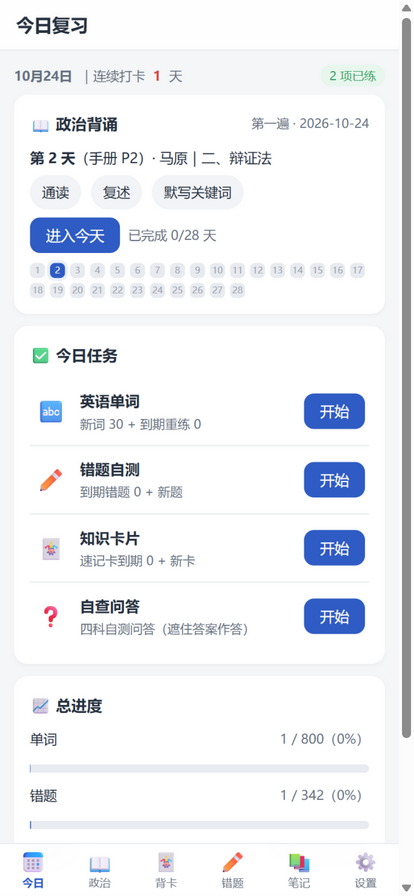
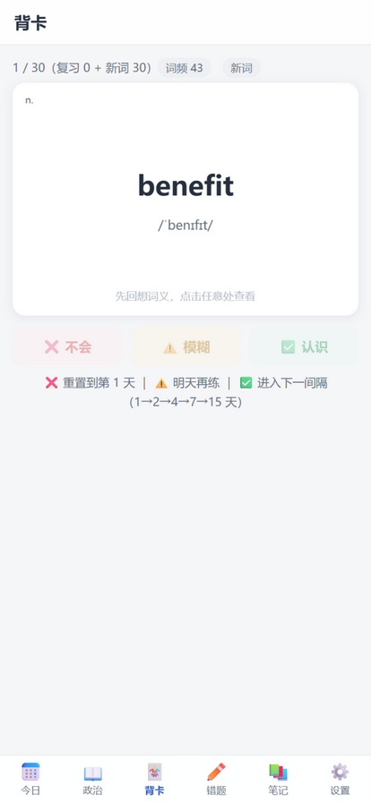

# 考研复习 App

把个人考研笔记库（408 四科 + 数学 + 英语 + 政治）变成一部安卓手机上的**离线复习应用**。
单 Activity WebView 壳 + 本地 HTML/JS 单页应用，**无 Gradle、无 AndroidX、无 maven 依赖**——`aapt2 → javac → d8 → zipalign → apksigner` 六步脚本直出 APK（约 4.3MB）。

<p float="left">
  
  
</p>

## 功能

| 模块 | 内容 |
|---|---|
| 今日 | 政治今日任务 + 各项聚合入口、连续打卡、总进度条 |
| 政治 | 28 天背诵日历、每日通读/复述/默写打卡、97 条原理翻面卡（含记忆关键词） |
| 背卡 | 英语 800 词（**艾宾浩斯曲线 1→2→4→7→15 天，答错重置；点任意处先看词义再评分；没记住的自动进生词本、可特训**）· **408 随机速记**（四科 938 个细粒度知识点，科目→章节两级范围筛选且选择持久化，混排打乱，先回想再揭示）· 52 套速记卡 1258 张 · 138 组自查问答 · 500 条三态自查清单 |
| 错题 | 四科客观题错题库 342 道（选择 329 + 综合 13），答题判分 + 本节漏洞要点 + 错题重现 |
| 笔记 | 201 篇笔记全文离线浏览 + 全文搜索，marked + KaTeX 公式渲染 |
| 设置 | 每日任务量、**检查更新（数据 + 应用代码，无需重装 APK）**、进度导出/导入 JSON |

复习调度：三档自评（✅ / ⚠️ / ❌）。单词走艾宾浩斯曲线；卡片/问答/错题为 +1/+3/+7 天重现，错项自动回流。

## 数据流水线

```
考研笔记库(D:\university_learning\考研, md)
        │  extractor/extract_data.py —— 六个解析器 + 全量自检（题数/词数/日期连续性…）
        ▼
   data/*.json（约 11MB：词表/28天计划/题库/速记卡/自查/笔记全文/目录树/搜索索引）
        │                      │
        │ 打包进 APK assets     │ 镜像到笔记站点仓库 site/appdata/
        ▼                      ▼
  离线开箱即用            GitHub Pages（在线更新源，jsDelivr + Pages 双源择新）
```

应用代码（`www/js/*.js` + `app.css`）同样双通道：APK 内置 + `site/appdata/code/` 在线覆盖，
由引导层 `boot.js` 决定加载来源——所以**改代码也能推送给手机，不用重装 APK**。

## 在线更新机制

- 设置页「检查更新」：并行拉取数据清单 `appdata/index.json` 与代码清单 `appdata/app_index.json`（均带时间戳与 sha）
- **双源择新**：jsDelivr 与 GitHub Pages 并行请求 manifest，取时间戳新的那份（规避 jsDelivr 对分支引用的缓存延迟）
- 数据按 sha 增量下载存 IndexedDB；代码整包存 localStorage，重启由 boot.js 启用（覆盖执行失败自动回退内置）
- 新装/重打包的 APK 自带更新代码（内置构建时间戳 ≥ 覆盖时间戳）时自动丢弃旧覆盖
- 不参与在线覆盖：`index.html`（稳定引导页）、`boot.js`、`vendor/` 第三方库——改这些才需重打 APK

## 构建

环境要求：JDK 17+（本机复用 IntelliJ 自带 JBR）、Android **build-tools 34.0.0** + **platforms;android-34**
（用 cmdline-tools 安装即可，不需要 Android Studio 与 Gradle）。

```bash
cd android
bash build.sh 6          # Windows 侧也可用 build.bat
# 产物 ../dist/考研复习.apk
```

首次构建自动 `keytool` 生成 `keystore/kaoyan.jks`（口令在脚本内，**密钥文件不入库**——
丢失后无法对已安装设备覆盖安装，请自行私有备份）。真机安装：传 APK → 允许"未知来源" → 安装。

桌面调试 UI 无需打 APK：

```bash
python -m http.server 8765     # 仓库根目录
# 浏览器打开 http://127.0.0.1:8765/www/index.html
```

## 目录结构

```
kaoyan-review-app/
├─ extractor/extract_data.py   # 数据提取：读笔记库 → data/*.json + site/appdata（数据+代码）
├─ data/                       # 生成的 JSON（提交入库，clone 即可构建）
├─ www/                        # 单页应用（index.html 引导页 + boot.js 代码加载器 + js/css + vendor）
├─ android/                    # 原生壳：MainActivity（WebView + assets 拦截供文件）、build.sh/bat、图标
├─ docs/                       # 截图
├─ keystore/                   # 签名密钥（gitignore，仅本地）
└─ dist/                       # 构建产物（gitignore）
```

## 已知边界

- 笔记图片不入 APK，渲染时在线加载（jsDelivr → Pages 兜底），正文文字离线可用
- 全文搜索索引剥离了 LaTeX，公式内容搜不到（正文渲染正常）
- 3 道综合应用题源笔记无标准答案，App 内展示要点自测
- 单词释义为真题语境释义（源词表口径），无例句

个人学习项目。笔记内容版权属于对应来源资料。
